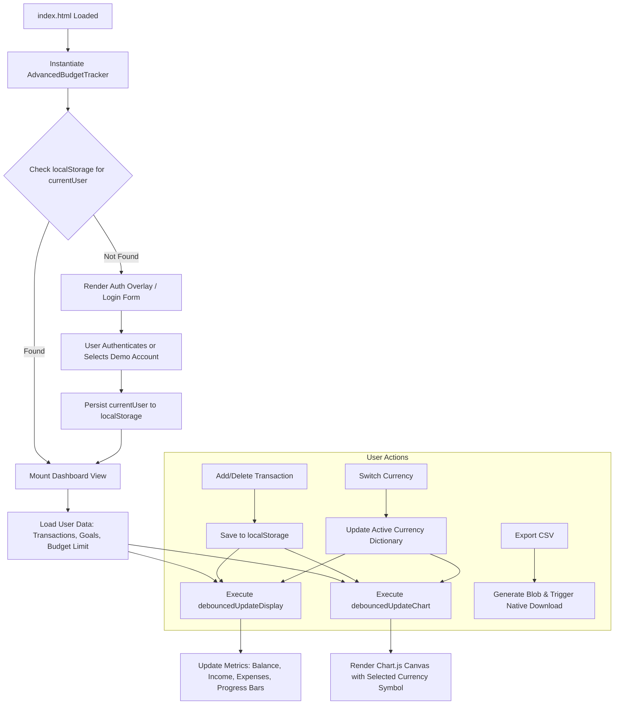

# Advance Budget Tracker Pro — Client-Side Financial Dashboard

[](index.html)
[](script.js)
[](https://www.chartjs.org/)
[](styles.css)
[](LICENSE)

> A client-side personal finance management application featuring multi-user browser authentication, category-driven income and expense tracking, dynamic multi-currency conversion, savings goal targets, Chart.js cash-flow analytics, and CSV transaction export.

---

## 01 — Overview

Managing personal finances often involves either over-engineered SaaS platforms that harvest sensitive banking credentials or clumsy manual spreadsheets that lack automated visual insights.

**Advance Budget Tracker Pro** is an intentionally lightweight, zero-backend financial dashboard that runs entirely inside the browser. It provides users with complete data sovereignty by storing all budgets, goals, and transaction ledgers locally using the browser's `localStorage` engine. 

### What You Can Learn from This Codebase
- **Object-Oriented UI Architecture:** Organized cleanly around an `AdvancedBudgetTracker` ES6 class with modular state management and event delegation.
- **Debounced DOM & Canvas Synchronization:** Employs custom debouncing (`this.debounce(...)`) to prevent layout thrashing when updating Chart.js instances and dynamic summary cards.
- **Dynamic Multi-Currency Modeling:** Implements a localized currency dictionary supporting 12 major global currencies that synchronizes currency symbols dynamically across forms, goals, and summary metric cards.
- **CSV Data Serializer:** Demonstrates client-side blob generation (`data:text/csv;charset=utf-8,...`) for exporting financial ledgers without backend dependencies.

---

## 02 — Demo & Interface Tour

The dashboard is structured into three primary workflows:

```text
┌────────────────────────────────────────────────────────────────────────┐
│ [Logo] Advance Budget Tracker Pro        [Currency: USD ▼] [Logout ⎋]  │
├────────────────────────────────────────────────────────────────────────┤
│ Total Balance: $4,250.00  │  Monthly Income: $5,800.00  │ Expenses: $1,550│
├───────────────────────────┴─────────────────────────────┴──────────────┤
│ ┌────────────────────────────────────┐ ┌─────────────────────────────┐ │
│ │  Cash Flow Trend (Chart.js Canvas) │ │  Add New Transaction        │ │
│ │  [7 Days] [30 Days] [90 Days]      │ │  • Income / Expense Toggle  │ │
│ │  ■ Income  ■ Expense               │ │  • Category, Amount, Date   │ │
│ └────────────────────────────────────┘ └─────────────────────────────┘ │
├────────────────────────────────────────────────────────────────────────┤
│ ┌────────────────────────────────────┐ ┌─────────────────────────────┐ │
│ │  Active Savings Goals              │ │  Recent Transactions        │ │
│ │  • Emergency Fund: [=========> ] 75%│ │  [Search...]  [Export CSV]  │ │
│ │  • New Laptop:     [====>      ] 40%│ │  Food, Salary, Utilities... │ │
│ └────────────────────────────────────┘ └─────────────────────────────┘ │
└────────────────────────────────────────────────────────────────────────┘
```

### Key UI Modules
1. **Authentication Overlay:** Modal gate with sign-in, registration, and built-in guest test user flow.
2. **Metric Summary Cards:** Real-time computation of Net Balance, Total Monthly Income, Monthly Outflow, and Budget Utilization.
3. **Interactive Cash Flow Canvas:** Dual-dataset Chart.js chart visualizing income vs. expenses across selectable time horizons (7, 30, and 90 days).
4. **Goal Milestones:** Target tracking with deadline countdowns and dynamic progress indicators.
5. **Transaction Ledger:** Tabular view featuring category tagging, deletion/editing, and CSV export.

---

## 03 — Features

### Implemented & Verified
- **Browser-Local Authentication:** Multi-account authentication simulation (`budgetUsers` repository in `localStorage`). Includes automatic seeding of a test account (`test@example.com` / `password123`).
- **Transaction Engine:** Categorized logging (Food, Utilities, Entertainment, Salary, Freelance, Investment, Other) with date picking and instant ledger recalculation.
- **Multi-Currency System:** Dynamic support for 12 currencies (`USD`, `EUR`, `GBP`, `JPY`, `CAD`, `AUD`, `CHF`, `CNY`, `INR`, `KRW`, `BRL`, `MXN`) with proper fractional decimal formatting and dynamic symbol injection.
- **Budget Threshold Alerts:** Live progress bar calculating spending against user-defined monthly caps.
- **Savings Goal Tracker:** Dedicated goal modal with target values, target completion dates, and dynamic completion percentages.
- **Client-Side CSV Export:** One-click generation and download of transaction history formatted for standard spreadsheet software.
- **Chart.js Analytics:** Responsive line and bar charts tracking spending velocity and daily cash flow changes.

### Limitations & Deliberate Scope Exclusions
- **No Remote Database Sync:** Transactions reside in browser `localStorage`. Clearing browser application cache deletes local records unless previously exported to CSV.
- **Client-Side Only Authentication:** Passwords are stored in browser storage for demonstration purposes. This is an educational UI application and does not provide cryptographic backend security.

---

## 04 — Architecture & State Management

The application operates as a single-page event loop driven by the `AdvancedBudgetTracker` class:



---

## 05 — Technology Stack

| Layer | Technology | Purpose |
| :--- | :--- | :--- |
| **Structure** | HTML5 | Semantic forms, accessibility labels, modal overlays |
| **Styling** | Tailwind CSS (CDN) + Custom CSS3 | Glassmorphism, animations (`slideInBounce`), responsive grid |
| **Application Logic** | JavaScript (ES6+ Classes) | OOP state management, debouncing, DOM manipulation |
| **Data Visualization** | Chart.js 4.x (via jsDelivr) | Dynamic line/bar canvas rendering of cash flow trends |
| **Persistence** | Browser `localStorage` API | User data persistence without server dependencies |
| **Tooling / Server** | Python / Node.js static server | Optional local development static file server |

---

## 06 — Installation & Setup

### Prerequisites
- Any modern web browser with JavaScript enabled.
- Optional: Python 3.x or Node.js to serve static assets locally.

### Local Execution

1. **Clone the repository:**
   ```bash
   git clone https://github.com/your-username/Advance-Budget-Tracker.git
   cd Advance-Budget-Tracker
   ```

2. **Start a local development server:**
   Using Python:
   ```bash
   python -m http.server 8000
   ```
   *Or using npm:*
   ```bash
   npm start
   ```

3. **Access the application:**
   Open `http://localhost:8000` in your browser.

4. **Sign in:**
   - Use the preconfigured test account:
     - **Email:** `test@example.com`
     - **Password:** `password123`
   - Or register a new local profile directly via the registration form.

---

## 07 — Usage Examples

### 1. Recording a Transaction
1. In the **Add Transaction** panel, toggle between **Expense** or **Income**.
2. Select a category (e.g., *Food & Dining*).
3. Enter the amount (currency symbol automatically mirrors the header selector).
4. Select the transaction date and click **Add Transaction**.
5. The balance cards and Chart.js timeline update immediately.

### 2. Exporting Records to CSV
Click the **Export CSV** button in the transaction table header. The browser immediately downloads a file formatted as:
```csv
Date,Type,Category,Amount,Description
2026-10-24,Income,Salary,5000.00,Monthly Compensation
2026-10-24,Expense,Food,85.50,Grocery Store
```

---

## 08 — Testing & Verification

The project has been verified across static syntax and runtime execution:

### Verification Results
- **JavaScript Syntax Check:** `node -c script.js` passed with **0 syntax errors**.
- **Static HTTP Asset Test:** Verified via local Python server on port 8089:
  - `index.html` — `HTTP 200 OK` (31,377 bytes)
  - `public/favicon.ico` — `HTTP 200 OK`
  - `public/favicon.svg` — `HTTP 200 OK`
  - `styles.css` — `HTTP 200 OK`
- **Functional Checks:** Validated `localStorage` schema isolation across multiple simulated user profiles.

---

## 09 — Project Structure

```text
Advance-Budget-Tracker/
├── index.html          # Main HTML structure, dashboard cards, modal views
├── script.js           # AdvancedBudgetTracker class, business logic, Chart.js driver
├── styles.css          # Custom styling, slide animations, glassmorphism tokens
├── public/
│   ├── favicon.ico     # Browser favicon
│   └── favicon.svg     # Scalable vector favicon
├── .env.example        # Reference environment settings (PORT configuration)
├── .gitignore          # Ignores build artifacts, logs, OS metadata
├── package.json        # Static server scripts (npm start / npm run dev)
├── LICENSE             # MIT License terms
└── README.md           # Authoritative project documentation
```

---

## 10 — License

This project is licensed under the **MIT License**. See the [`LICENSE`](./LICENSE) file for complete details.

- **Author & Copyright:** (c) 2026 Ashmit Prasad.
